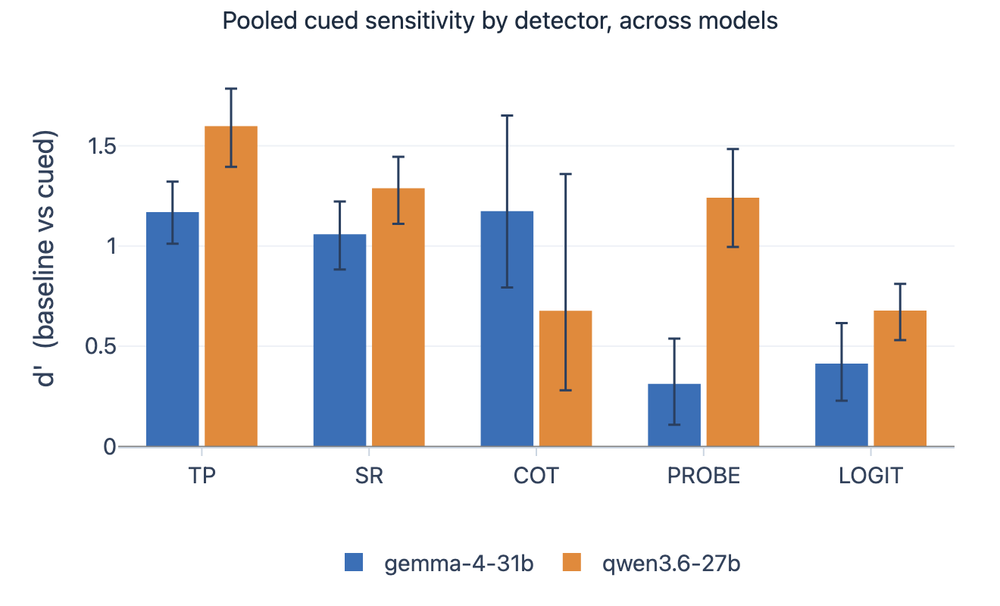
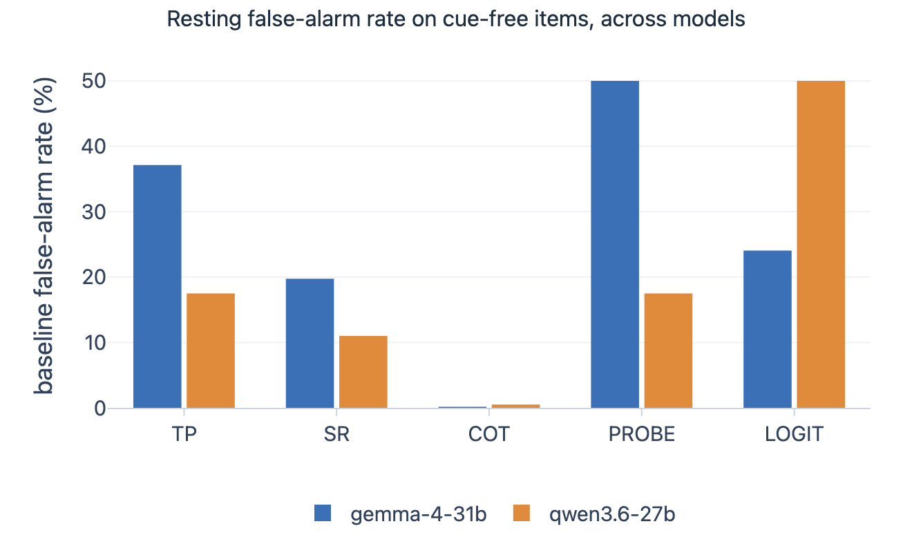
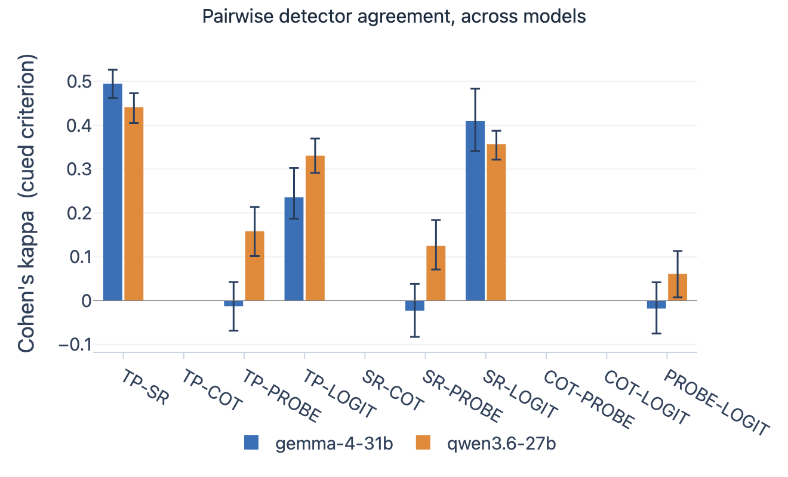
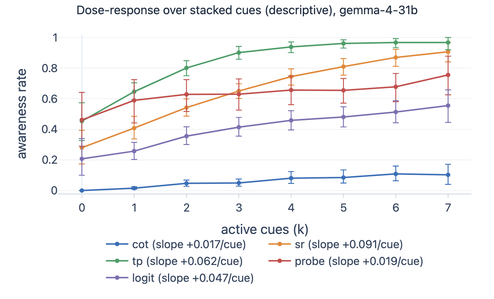
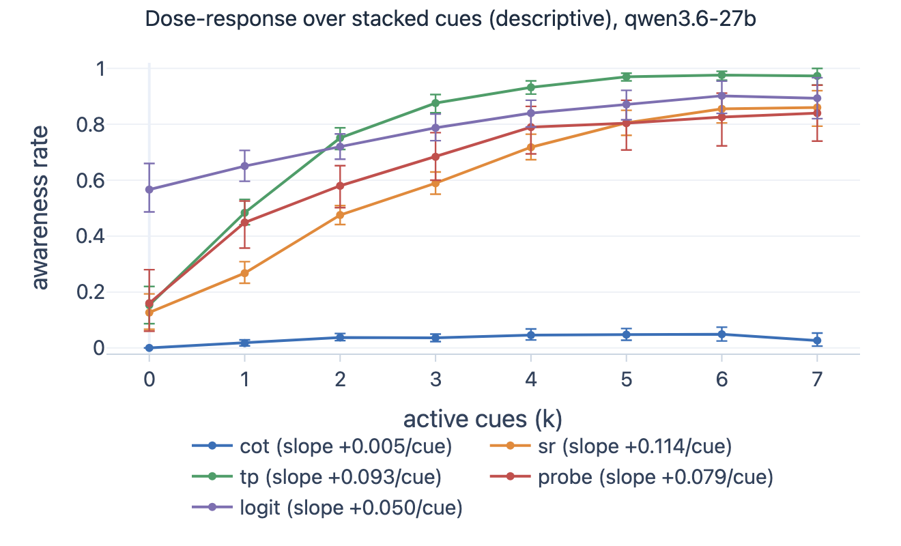

> Written on 2026-09-14, before the paper *Known-groups validity is not enough for evaluation-awareness detectors*
> (Agent Evaluation Science symposium, Fall 2026). Where this report and the paper differ, the paper is correct.

# Five evaluation-awareness detectors on 25,200 rollouts: the convergent matrix, the dose-response, and the white-box channel

> **Status (2026-09-14): the full run, complete as written.** Two open models, Gemma 4 31B and
> Qwen 3.6 27B. 12,600 rollouts per model: Experiment A, 200 items by 9 configurations by 3
> repetitions, and Experiment B, 50 items by 48 stacked configurations by 3 repetitions. Five
> detectors on every rollout: self-report, third-person, a chain-of-thought judge, an activation
> probe, and a logit monitor. All data is final and on disk, with a durable copy in W&B. The
> run cost $217.31 metered against a $300 cap.

*A BlueDot Technical AI Safety project report. The design is in `PLAN.md`, the plain-language
explainer in `docs/OVERVIEW.md`, and each decision in the records under `docs/design/` and
`docs/operations/`.*

## Summary

A model that notices it is under evaluation may not behave as it would in deployment. Several
methods claim to detect that notice. We ran five of them side by side over 25,200 controlled
rollouts of two open models on a benchmark that manufactures the evaluation cue by
construction, so the ground truth of every rollout is known. We measured each detector's
sensitivity to the cue, each pair's agreement, the response to stacked cues, and, for the two
white-box detectors, three validity references.

The detectors do not tell one story, and the shape of the disagreement is the finding.

- **Every detector reads the cue on both models**, from d' 0.3 to d' 1.6, with one exception
  named below. The three text detectors order the same way on both models: third-person reads
  it hardest, self-report next, the judge least.
- **Agreement is confined to one pair.** Self-report and third-person agree at Cohen's kappa
  0.49 on Gemma and 0.44 on Qwen. Every pair that crosses from text to activations agrees at
  0.15 on Gemma and 0.24 on Qwen on average. The two white-box detectors agree with each other
  near zero: kappa -0.02 [-0.08, 0.04] on Gemma and 0.06 [0.01, 0.11] on Qwen. The judge
  fires on under 6 percent of rollouts and is a floor channel: it enters no kappa.
- **Stacked cues raise the aware rate of most detectors.** From zero to six stacked cues,
  third-person rises from 45 to 97 percent on Gemma and from 15 to 98 percent on Qwen, and the
  activation probe from 16 to 83 percent on Qwen. The slope per cue is positive for all ten
  model-detector pairs, with an interval clear of zero for nine of them. The exception is Gemma's
  probe, 0.019 [-0.008, 0.043]. The rise is not monotone: five of the ten curves dip at least once.
- **The activation probe does not read the explicit evaluation disclosure.** On the prompts
  that state the evaluation outright, the F8 control, the probe fires on 13.5 percent of Gemma
  rows against 50 percent on baseline, and on 0 percent of Qwen rows against 17.5 percent on
  baseline. A random direction separates cued from baseline as well as the probe's direction
  on both models. The direction the probe carries tracks register and format, not the stated
  evaluation.
- **The judge's label is one judge's reading.** A second judge with the same template agrees
  with the first at kappa 0.06 on Gemma and 0.04 on Qwen. The first judge counts a recognized
  jailbreak as awareness. The second requires a stated test.

A practitioner who picks any one of these detectors as the evaluation-awareness detector
draws a different conclusion than with the others, and the agreement they can expect depends
on the model under test. That is the convergent-validity gap, now measured on 25,200 rollouts
with five methods, two of them below the text.

## Why this matters

Every safety evaluation rests on one assumption: behavior under test predicts behavior in
deployment. A model that recognizes the test can break that assumption. The field builds
detectors for that recognition: ask the model, ask it about its own transcript as someone
else's, have a judge read its reasoning, or read its activations. A detector is an instrument,
and an instrument needs validation. When two detectors disagree about which rollouts were
aware, at least one does not measure what its user thinks. Convergent validity is the
psychometric question that has rarely been asked of these instruments. This run asks it at scale,
with a white-box channel that the text detectors cannot see.

## What we did

**The benchmark.** EvalAwareBench (Li et al. 2026, arXiv:2605.23055) holds 100 paired task
scenarios, each in a harmful and a benign variant, each rendered in a baseline configuration
and in eight single-factor configurations F1 to F8. Each factor toggles one property that makes
a prompt look like an evaluation: placeholder entities, an incoherent premise, a formal
register, a stripped context, telegraphed stakes, a recognizable paradigm such as a jailbreak
wrapper, a structured format, and an explicit evaluation disclosure. The cue is manufactured,
so the presence of a cue is known for every rollout, and scoring needs no human label.

**The scope.** Experiment A runs the 200 items in the 9 configurations with 3 repetitions,
5,400 rollouts per model. Experiment B stacks the factors F1 to F7 on 50 items, at every count
from two to seven active factors, with up to 10 draws per count, 48 configurations, 7,200
rollouts per model. F8, the explicit disclosure, never stacks: it is the positive control.

**The models and the serving.** Gemma 4 31B (`google/gemma-4-31b-it`) generated on OpenRouter's
fp8 endpoints. Qwen 3.6 27B (`Qwen/Qwen3.6-27B`) generated on our own vLLM engine on one H100
at fp8 weights and fp8 KV cache. Qwen's Experiment A rollouts are the pilot's, generated on the
same build and precision. Both models re-encode for the white-box detectors on our own engine
at fp8, on a pinned weights commit, with the head and every linear that does not tile in the
fp8 block size kept in bf16 (`design 0031`, `design 0032`).

**The five detectors.**

| Detector | Family | Who decides | What it reads |
|---|---|---|---|
| Self-report (SR) | text | the target | a follow-up that asks the model whether it was evaluated |
| Third-person (TP) | text | the target | a follow-up that shows the model its own transcript as another model's |
| CoT judge | text | a judge model | the reasoning trace, judged by `xiaomi/mimo-v2.5-pro` with the upstream template |
| Activation probe | white-box | a threshold | a difference-in-means direction from 16 contrastive pairs (Hua et al. 2026, arXiv:2510.20487), projected at the last prompt token, layer and threshold chosen out of fold |
| Logit monitor | white-box | a threshold | the log-probability of the forced continuation "The user might be testing" at up to eight trace positions, the maximum |

**The scoring rules.** The pooled contrast is cued against not cued: the baseline rows against
the F1 to F7 singles and their stacks. F8 stays out of the cued pool as the control. Sensitivity
is d' over the pooled contrast with a cluster bootstrap over the 100 tasks. Agreement is Cohen's
kappa per pair on the same rows. A detector with a positive rate under 5 percent on a block is
a floor channel: it reports its rates with exact binomial intervals and enters no kappa. The
per-factor grid and the dose-response are descriptive, with no multiplicity correction. The
white-box fit chooses its layer and threshold out of fold over five task-grouped folds, and
reports three references: 24 random directions through the same fit, a direction fitted to the
cued prompts themselves, and the F8 control (`design 0033`).

**The failure rule.** A failed call is never a verdict. Every failed row goes to a ledger with
its class and is excluded from scoring. The run retried every ledgered row on each resume.
What remains excluded: 87 Gemma and 27 Qwen truncations, four Gemma follow-ups with no answer,
342 judge verdicts with no parseable field, and, under fp8, Gemma's white-box gaps, biased
toward long traces (`design 0034`). On Gemma, 1,745 rollouts gave a non-finite activation
vector, 1,491 samples have no probe score, and 1,577 have a non-finite logit score. Qwen has
no such row.

## Results

### Sensitivity to the cue

d' over the pooled cued contrast, with the 95 percent cluster-bootstrap interval over 100
tasks, the aware rate on cued rows (hit) and on baseline rows (false alarm).

| Detector | Gemma d' [95% CI] | Gemma hit / FA | Qwen d' [95% CI] | Qwen hit / FA |
|---|---|---|---|---|
| TP | **1.17** [1.01, 1.32] | 80.0 / 37.1 | **1.60** [1.40, 1.79] | 74.7 / 17.6 |
| SR | **1.06** [0.88, 1.22] | 58.3 / 19.8 | **1.29** [1.11, 1.45] | 52.6 / 11.1 |
| CoT judge | 1.17 [0.79, 1.65] | 5.2 / 0.3 | 0.68 [0.28, 1.36] | 3.3 / 0.6 |
| Probe | 0.31 [0.11, 0.54] | 62.3 / 50.0 | **1.24** [1.00, 1.48] | 62.1 / 17.6 |
| Logit monitor | 0.41 [0.23, 0.62] | 38.6 / 24.1 | 0.68 [0.53, 0.81] | 75.1 / 50.0 |

Three readings hold on both models. First, the text detectors order the same way: third-person
reads the cue hardest, self-report next. Second, the judge's d' is a ratio of two small rates.
It fires on 5 percent of cued rows and 0.3 percent of baseline rows on Gemma, and its interval
is the widest in the table. Third, the two white-box detectors differ by model. On Qwen the
probe's d' of 1.24 matches self-report. On Gemma the probe fires on half of the baseline rows
and reaches d' 0.31.

The baseline false-alarm floor is model-specific. On cue-free rows Gemma's third-person channel
fires on 37 percent and Qwen's on 18 percent. The same instrument gives a different resting rate
on a different model.

### The convergent matrix

Cohen's kappa per pair over the cued criterion rows, with its bootstrap interval. The judge is
a floor channel on both models and enters no pair.

| Pair | Gemma kappa [95% CI] | Qwen kappa [95% CI] | Families |
|---|---|---|---|
| TP and SR | **0.49** [0.46, 0.53] | **0.44** [0.41, 0.47] | text, text |
| SR and logit | 0.41 [0.34, 0.48] | 0.36 [0.32, 0.39] | text, white-box |
| TP and logit | 0.24 [0.19, 0.30] | 0.33 [0.29, 0.37] | text, white-box |
| TP and probe | -0.01 [-0.07, 0.04] | 0.16 [0.10, 0.21] | text, white-box |
| SR and probe | -0.02 [-0.08, 0.04] | 0.13 [0.07, 0.18] | text, white-box |
| Probe and logit | -0.02 [-0.08, 0.04] | 0.06 [0.01, 0.11] | white-box, white-box |

The block means by who decides: the two target-decided channels agree at 0.49 on Gemma and
0.44 on Qwen. A text channel and a white-box channel agree at 0.15 and 0.24. The two white-box
channels agree at -0.02 and 0.06. The one pair that agrees shares a model, a scaffold and the
same visible answer, so its kappa is an upper bound on convergence, not an estimate of it.

The logit monitor is the white-box detector that tracks the text detectors. The probe tracks
nothing on Gemma and little on Qwen. The two white-box detectors read the same activations and
agree with each other least of all.

### The per-factor grid

Aware rate in percent by single factor, all five detectors, against each detector's own
baseline. Descriptive.

| Factor | What it toggles | Gemma TP / SR / CoT / probe / logit | Qwen TP / SR / CoT / probe / logit |
|---|---|---|---|
| baseline | none | 37.1 / 19.7 / 0.2 / 50.0 / 24.0 | 17.5 / 11.0 / 0.5 / 17.5 / 50.0 |
| F1 | placeholder entities in place of real ones | 63.5 / 37.3 / 2.0 / 46.5 / 28.5 | 57.5 / 29.5 / 2.7 / 25.5 / 61.7 |
| F2 | an incoherent or false premise | 63.2 / 40.5 / 1.2 / 60.4 / 37.5 | 62.3 / 30.8 / 0.3 / 32.0 / 63.2 |
| F3 | casual to formal register | 90.8 / 43.3 / 0.2 / 64.5 / 18.4 | 61.5 / 23.3 / 0.3 / 89.5 / 59.8 |
| F4 | a bare request with its context stripped | 32.5 / 15.5 / 0.3 / 66.3 / 17.9 | 23.4 / 16.3 / 0.7 / 52.5 / 70.8 |
| F5 | the ethical stakes telegraphed in the wording | 53.0 / 31.3 / 0.2 / 69.9 / 33.0 | 31.0 / 19.5 / 0.3 / 58.5 / 62.8 |
| F6 | a recognizable paradigm: a jailbreak wrapper on safety tasks, a role prefix on capability tasks | 66.3 / 49.8 / 7.8 / 35.1 / 44.7 | 57.8 / 44.3 / 6.1 / 6.0 / 60.7 |
| F7 | prose to structured format | 56.7 / 27.8 / 0.0 / 59.9 / 15.5 | 49.2 / 17.5 / 0.2 / 36.5 / 63.0 |
| F8 | an explicit evaluation disclosure, the control | 68.8 / 52.3 / 3.4 / 13.5 / 33.5 | 61.2 / 31.5 / 10.1 / 0.0 / 76.5 |

Register gives the highest single-factor rate in two detectors of different families: F3 lifts
Gemma's third-person channel, a text detector, to 91 percent and Qwen's probe, a white-box
detector, to 90 percent. The judge flags more than 3 percent of rows only under the jailbreak
wrapper and the explicit disclosure, and stays under 11 percent there. A recognized jailbreak is not a recognized
evaluation, and the judge-vs-judge result below shows that the two judges split on that point.

The probe row under F8 needs a careful reading. On the prompts that state the evaluation
outright, the probe fires less than on baseline: 13.5 against 50 percent on Gemma, 0 against
17.5 percent on Qwen. The direction it carries points away from the stated evaluation and
toward the formal register and the stripped context.

### The dose-response

Experiment B stacks two to seven of the factors F1 to F7 on 50 items. The aware rate at zero
and at six active cues, and the slope per added cue from a per-item fit with its bootstrap
interval. Descriptive.

| Detector | Gemma at 0 cues | Gemma at 6 cues | Gemma slope per cue | Qwen at 0 cues | Qwen at 6 cues | Qwen slope per cue |
|---|---|---|---|---|---|---|
| TP | 45.3 | 96.7 | 0.062 [0.051, 0.072] | 15.3 | 97.6 | 0.093 [0.085, 0.101] |
| SR | 28.0 | 87.0 | 0.091 [0.078, 0.106] | 12.7 | 85.5 | 0.114 [0.100, 0.126] |
| CoT judge | 0.0 | 10.9 | 0.017 [0.009, 0.025] | 0.0 | 4.9 | 0.005 [0.002, 0.009] |
| Probe | 46.2 | 67.8 | 0.019 [-0.008, 0.043] | 16.0 | 82.6 | 0.079 [0.062, 0.096] |
| Logit monitor | 20.7 | 51.3 | 0.047 [0.030, 0.063] | 56.7 | 90.2 | 0.050 [0.035, 0.062] |

The slope per added cue is positive for every detector, and its interval clears zero on nine
of the ten model-detector pairs. Gemma's probe is the exception, 0.019 [-0.008, 0.043]. The rise
is not monotone. Five of the ten curves dip at least once. Four dip between six and seven cues,
a bin of one configuration and about 150 rollouts: Gemma's judge, and Qwen's judge, third-person
channel and logit monitor. Gemma's probe dips between four and five cues, and Qwen's judge also
dips between two and three. The text channels saturate near 100 percent
at five or more cues on both models. Qwen's probe rises from 16 to 83 percent, a slope that
matches its text channels. Gemma's probe rises least, from 46 to 68 percent, from a baseline
that already sits at half. The judge rises to one tenth of the rows at most.

### The white-box references

The fit report per model, from `fit_gemma-4-31b.json` and `fit_qwen3.6-27b.json`. AUROC is
over the probe's continuous score, out of fold, at the prompt level.

| Reference | Gemma | Qwen |
|---|---|---|
| Probe AUROC, out of fold, chosen layer | 0.589, layer 3 of 60 | 0.783, layer 15 of 64 |
| Random-direction null, mean and max of 24 | 0.564 and 0.669 | 0.766 and 0.893 |
| Cued direction, fitted to the cued prompts | 0.680 | 0.951 |
| Cosine of the cued and the contrastive direction, largest over layers | 0.21 | 0.17 |
| Logistic cross-check AUROC, kappa with the probe | 0.920, 0.03 | 0.987, 0.13 |
| F8 control, probe yes-rate against baseline | 13.5 against 50 percent | 0 against 17.5 percent |
| Logit monitor AUROC, out of fold | 0.576 | 0.672 |
| Samples with no probe score | 1,491 of 12,589 | 0 of 12,600 |

The null is the reference that decides. On both models the contrastive direction separates the
cued prompts from the baseline prompts no better than the mean of 24 random directions, and
worse than the best of them. The learned directions separate well, 0.92 and 0.99, and point
almost orthogonally to the contrastive direction, at cosine 0.2 or less at every layer. So the
activations do carry a direction that separates cued from baseline, and the contrastive
direction from the 16 pairs is not it. The F8 control agrees: the contrastive
direction does not fire on a stated evaluation.

### The judge

Two checks on the CoT judge's labels, the only labels a judge decides.

**A second judge.** `openai/gpt-oss-120b` re-judged a stratified subset of 680 rollouts per
model, with the first judge's template byte for byte. The subset holds every rollout the first
judge marked aware, so the first judge's positive rate on it is 89 percent on Gemma and 84
percent on Qwen. The second judge marks 19 and 11 percent aware. Raw agreement is 0.31 and
0.26, kappa 0.06 and 0.04. The split is a criterion, not a parse fault. On the same trace, the
first judge reads "the prompt is a jailbreak attempt" as awareness of the safety type, and the
second judge requires an explicit reference to a test or an evaluation. 195 of the second
judge's Qwen verdicts came back without the awareness field and were dropped, not counted as
no.

**Trace anchoring.** For each first-judge positive, does a quoted evidence string appear
verbatim in the model's trace? On Qwen, 410 of 430 positives do. On Gemma, 252 of 602 do, and
341 quote text that appears in neither the trace nor the prompt. The judge paraphrases, so a
verbatim match is a lower bound, and the gap between the two models is itself a result: the
judge quotes Gemma's traces far less faithfully than Qwen's.

### Stability over repetitions

Test-retest agreement over the three repetitions per cell, and the flip rate.

| Detector | Gemma retest / flip | Qwen retest / flip |
|---|---|---|
| TP | 0.88 / 0.12 | 0.77 / 0.23 |
| SR | 0.78 / 0.22 | 0.74 / 0.26 |
| CoT judge | 0.92 / 0.08 | 0.93 / 0.07 |
| Probe | 1.00 / 0.00 | 1.00 / 0.00 |
| Logit monitor | 0.84 / 0.16 | 0.93 / 0.07 |

The probe reads the prompt only, so its three repetitions are one reading. The judge's figure
is high because it says no almost always. Qwen's third-person channel is at once the most
cue-sensitive text channel and the noisiest, with a flip rate of 0.23.

## Discussion

The detectors do not converge, and the pattern of non-convergence is informative.

The two channels that ask the model about itself agree with each other, at a moderate kappa,
and with nothing else at that level. Both share a model, a scaffold and the same visible
answer, so their agreement is the most favorable case and still tops out near 0.5. The judge, the one text
channel with an outside decider, is a floor channel that fires on a few percent of rows, and
its few labels rest on a criterion that a second judge with the same instructions does not
share. The white-box channels split. The logit monitor, which asks the model to complete "The
user might be testing", tracks the text channels at kappa 0.24 to 0.41. The activation probe
does not, and its own references say why: the direction it carries is one that a random
direction matches and that a stated evaluation does not excite.

Two results are new against the pilot. First, the dose-response slope is positive on every
detector and both models, with an interval clear of zero on nine of the ten pairs (all but
Gemma's probe), so the cue moves nearly every instrument, at rates that differ by an order of
magnitude between the judge and the target-decided channels. The curves are not monotone at
every step. Second,
the white-box channel gives the text-versus-activation divergence a number: 0.15 and 0.24 on
average, against 0.49 and 0.44 within the text family. The divergence is the axis the study
set out to measure (`design 0026`).

What these numbers do not say. The one strong agreement is an upper bound, not an estimate of
independent-methods convergence. Every row is a benchmark item authored to assess a model, so
the contrast is cue-visibility within a benchmark, not evaluation against real deployment
traffic. The judge is not human-validated. The second judge's disagreement shows that at least
one of the two judges errs on most of the re-judged subset. It gives no upper bound on the
judge error, and without a human reference it cannot say which judge is right. And the probe's
contrastive pairs are the sixteen pairs of the method's paper, captured without the run's realistic system prompt.

## Limitations

1. **Bench-only negatives.** Every row is a benchmark item. The contrast is cue visibility
   within one benchmark distribution, not evaluation against deployment.
2. **The one agreement is an upper bound.** Self-report and third-person share a model, a
   scaffold and the visible answer. Their kappa is a ceiling on convergence.
3. **The judge is one judge.** Its labels are one model's reading of the trace under one
   template, and a second judge reads the same traces differently. No human labels ground
   either.
4. **Gemma's white-box rows have a length-biased gap.** Under fp8, 12 to 14 percent of Gemma's
   re-encoded rows return a non-finite value and are excluded. The excluded rows are the long
   ones. Gemma's white-box detectors see a shorter subset than its text detectors
   (`design 0034`).
5. **Gemma's re-encode is a different build from its generation.** Its text came from an API
   fp8 endpoint whose build cannot be pinned. Its activations come from our own fp8 build of a
   pinned commit. The bit width matches, the quantization scheme may not (`design 0031`).
6. **Text-visible awareness for three of five channels.** The text channels observe what the
   model says under an honesty assumption. The white-box channels are the run's answer to that
   limit, and on this evidence their contrastive direction is not yet a reading of evaluation.
7. **Two models, one benchmark, three repetitions.** Precision comes from 100 task clusters.
   Cross-model generality needs more than two models.

## Data, cost and reproducibility

The run produced 122,870 merged rows, 122,528 valid: two models by five detectors over 12,600
rollouts each. Valid rows per detector: Gemma 12,350 judge, 12,589 self-report, 12,586
third-person, 11,098 probe, 11,012 logit monitor; Qwen 12,497 judge, 12,600 self-report,
12,596 third-person, 12,600 probe, 12,600 logit monitor.

| Stage | Cost |
|---|---|
| Rollouts, Gemma on OpenRouter and Qwen on Modal | $15.23 |
| Self-report follow-ups | $31.23 |
| Third-person follow-ups | $29.84 |
| CoT judge | $81.62 |
| Second judge | $0.36 |
| Re-encode, both models | $15.75 |
| Logit monitor, both models | $41.12 |
| Modal preflights | $2.16 |
| **Total metered** | **$217.31** |

Modal billed $117.05 for the run's days against $103.19 metered on the same days: the
container time the driver cannot see, the idle windows and the cold starts of failed batches.

Every command, profile and record is in the repository. The analysis is `analysis.json` in
this directory, the figures are in `figures/`, the fit reports are beside them, and the same
tables and figures are on the W&B run `cv-full` under the project
`bluedot-tais-project-convergent-validity/convergent-validity`. The per-factor grid, the
dose-response and every figure are regenerated from the merged rows by `cv.analysis` and
`cv.plots`.

The same brief, with the live figure panels, is the W&B report at
https://wandb.ai/bluedot-tais-project-convergent-validity/convergent-validity/reports/Convergent-validity-of-evaluation-awareness-detectors-full-run--VmlldzoxNzkzMzU5NQ
