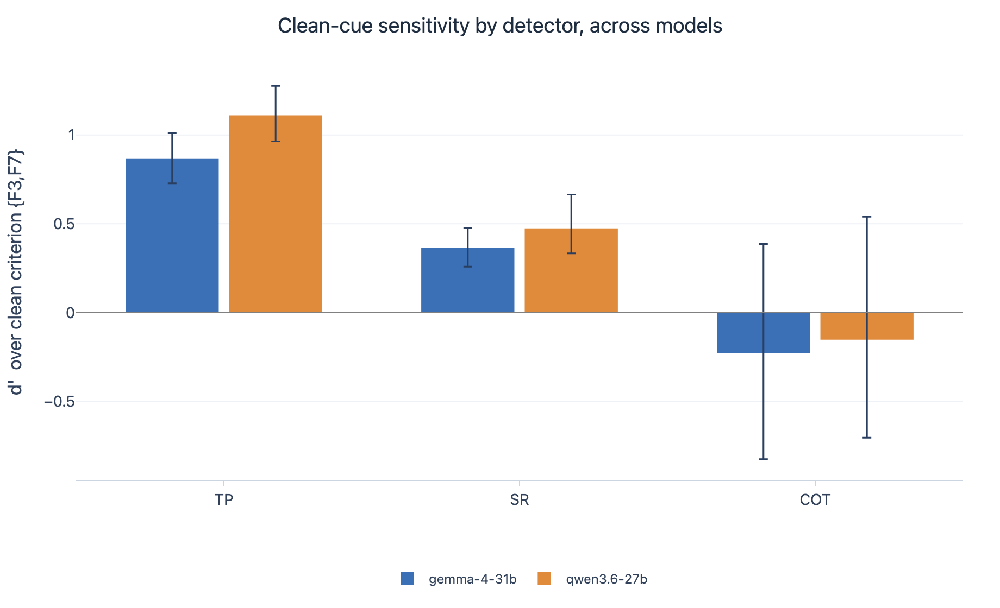
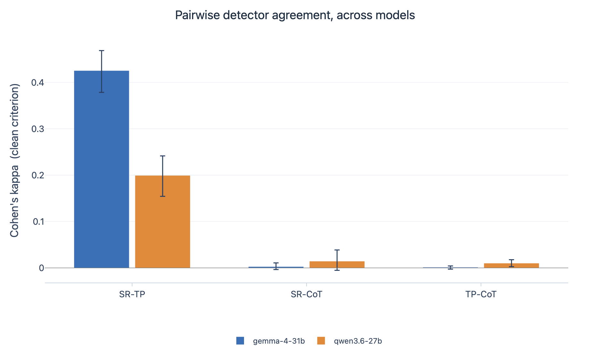
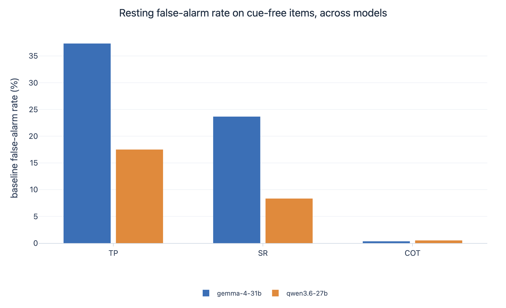

> Written on 2026-06-13, before the paper *Known-groups validity is not enough for evaluation-awareness detectors*
> (Agent Evaluation Science symposium, Fall 2026). Where this report and the paper differ, the paper is correct.

# Do evaluation-awareness detectors agree with each other? A first measurement

> **STATUS (2026-06-13): pilot, complete as written.** This is the **complete two-model convergent
> matrix** at 100-task scale: all three verbalized detectors (self-report, third-person, CoT-judge)
> ran across all 10,800 rollouts of both models (Gemma 4 31B and Qwen 3.6 27B). All data is final and
> committed. We under-claim by design: this is a within-benchmark cue-sensitivity-and-convergence
> result on two models, a pilot-grade preliminary, not a validity verdict.

*A BlueDot Technical AI Safety project write-up. Pilot results; the full experiment
(adds a third model, real-traffic controls, and a white-box probe) is the follow-up paper.*

## Summary

When a language model is being evaluated, the text it sees often gives that away, and a model that
notices may behave differently than it would in deployment. Several methods claim to detect this
"evaluation awareness." We ran three of them, side by side, over 10,800 controlled rollouts of two
open ~30B models (Gemma 4 31B, Qwen 3.6 27B) on a benchmark that manufactures the evaluation cue by
construction, so ground truth is known for every single sample. We measured how sensitive each
detector is to the cue, and, the part most work skips, **whether the detectors agree with each
other** about which interactions the model "noticed." The headline: **they do not agree, the
disagreement replicates across both models, and how much they agree is itself model-dependent.** The
three detectors split two-against-one on both models. The two channels that ask the model about
itself, self-report (SR) and third-person (TP), both track the cue (TP strongly, SR weakly) and are
the only pair that agrees at all. The third channel, a judge model reading the chain of thought,
fires on under 2% of rollouts, is at chance on the cue (d'≈0) on both models, and agrees with
**neither** of the other two. And the one agreement that exists is fragile: SR-TP convergence is
Cohen's kappa **0.43** (clean cue) on Gemma but only **0.20** on Qwen, and the false-alarm floors
differ just as sharply (Gemma self-reports "being evaluated" on 24% of cue-free items, Qwen on
8%). A practitioner picking any single one of these as "the" eval-awareness detector would draw a
materially different conclusion than with the others, and a different one again on a different
model. That is the convergent-validity gap, now measured directly across two models. (Even the
agreement we do see, SR vs TP, is an upper bound: those two share a model, a scaffold, and the same
answer, and in this pilot TP also saw the reasoning trace, so their convergence is contaminated by
shared evidence, not independent-methods agreement.)

## Why this matters

Every safety evaluation rests on an assumption: that behavior under test predicts behavior in
deployment. A model that recognizes "this is a test" can break that assumption, so the field is
building detectors for evaluation awareness: ask the model (self-report), ask it about its own
transcript as if it were someone else's (third-person), have a judge model read its chain of
thought (CoT), or probe its activations directly.

But a detector is a measurement instrument, and instruments need validation. If two detectors
disagree about *which* rollouts were "aware," at least one of them is not measuring what we think
it measures. Convergent validity is a standard psychometric question, and it has rarely been asked of
these tools. That is the gap this project starts to fill, deliberately at a small scale first.

## What we did

We ran **EvalAwareBench** (Li et al. 2026, arXiv:2605.23055), a benchmark of 100 paired task
scenarios, each rendered in a harmful ("safety") and benign ("capability") variant and in 9
configurations: a baseline plus eight factors (F1-F8) that each toggle one eval-looking property
of the wrapper (register, format, disclosed stakes, an explicit evaluation disclosure, and so on).
Because the benchmark *manufactures* the cue, we know with certainty whether an evaluation cue was
present in every rollout: detector scoring needs no human labels.

- **Models:** `gemma-4-31B-it` and `Qwen3.6-27B`. **Rollouts were self-hosted** on Modal via vLLM
  with full reasoning traces preserved, so the CoT channel does not depend on a provider's trace policy;
  generation validated at 100% trace presence. Per the **operations-0013 hybrid serving** decision
  (see "Status and scope"), each model runs where it is cheapest: Gemma's rollouts on
  an H200 (bf16) with its introspection and judging on the OpenRouter API, Qwen self-hosted
  end-to-end on an H100 in **FP8** (the expensive-output model, for which self-hosting costs less). The CoT
  judge is `xiaomi/mimo-v2.5-pro` on OpenRouter throughout (design 0021).
- **Scale:** 100 tasks x 2 valences x 9 configs x 3 replications x 2 models = **10,800 rollouts**,
  sampled at the benchmark's T=0.3. Every detector ran on all rollouts (**32,400 detector verdicts**;
  116 dropped as unparseable, 32,284 valid), a balanced grid (600 per config per model).
- **Detectors (the upstream paper's protocol, unmodified):**
  - **CoT**: a judge model reads the rollout's reasoning trace (plus prompt and answer) and rules
    whether the model's own reasoning shows it recognized an eval.
  - **SR (self-report)**: the model is asked post-hoc, in its own conversation, whether it was
    being evaluated.
  - **TP (third-person)**: the model is shown the transcript as an outside observer and asked
    whether it looks like an evaluation.
- **Scoring:** the clean cue criterion is {F3 (register), F7 (format)}: the only two factors that
  change the prompt's costume without changing the task, so detection there can only be
  recognition-from-style. All eight factors are reported in a per-factor sweep. Sensitivity is d'
  (with a count-symmetric correction and raw counts; d' is reported as undefined rather than
  fabricated when a detector never fires). Agreement is Cohen's kappa with task-cluster bootstrap
  CIs, reported at rep level and as cell-level majority-of-three, partitioned by who decides
  (judge vs the model itself), with exact binomial intervals on conditional probabilities where
  base rates make kappa undecidable.

Everything runs on the upstream paper's own prompts, verbatim. The pipeline is chunked, resumable,
and checkpointed to W&B, because the run happened overnight and interruptions
were expected.

## Results

All three detectors completed across all 5,400 rollouts of **each** model: a fully populated,
100-task, two-model measurement of both halves of the question: how sensitive each detector is to
the cue, how much the detectors agree with each other, and whether either result is stable across
models.

**Sensitivity, clean cue {F3, F7} vs baseline, 100 tasks, reps=3:**

| Detector | Gemma d' [95% CI] | Gemma hits / FA | Qwen d' [95% CI] | Qwen hits / FA |
|---|---|---|---|---|
| CoT (judge) | **≈0** (−0.23) [−0.83, 0.39] | 2/1186 · 2/587 | **≈0** (−0.15) [−0.70, 0.54] | 4/1186 · 3/587 |
| **SR** (self-report) | **0.37** [0.26, 0.48] | 436/1200 · 142/600 | **0.47** [0.33, 0.66] | 219/1200 · 50/600 |
| **TP** (third-person) | **0.87** [0.73, 1.01] | 849/1200 · 224/600 | **1.11** [0.96, 1.28] | 685/1200 · 105/600 |

The cue-sensitivity *ordering* replicates exactly across both models: third-person reads the cue
hardest, self-report weakly, the CoT-judge not at all (it fires a handful of times on ~1,200 cue
items and a handful on ~600 cue-free ones, at its own noise floor; the small negative d' is the
never-fires artifact, read as "no detectable sensitivity"). On both models SR is small-but-resolved
(CI excludes 0) and TP is the most sensitive. Qwen is slightly more cue-sensitive on
the two model-introspection channels (TP d'=1.11 vs Gemma's 0.87).

**The convergent matrix, pairwise Cohen's kappa (the part most work skips):**

| Pair | Gemma: clean / all-configs | Qwen: clean / all-configs | reading |
|---|---|---|---|
| **SR ∩ TP** | **0.43** [0.38, 0.47] / **0.53** [0.50, 0.56] | **0.20** [0.15, 0.24] / **0.30** | the only agreeing pair; a shared-evidence **upper bound** |
| SR ∩ CoT | ≈0 / 0.04 | ≈0 / 0.09 | CoT base rate <0.5%: exact-binomial, not kappa |
| TP ∩ CoT | ≈0 / 0.02 | ≈0 / 0.04 | same |

Two things hold on both models. First, **only the two model-introspection channels agree at all**,
and the external judge converges with neither, in either direction. Partitioning by *who decides*
makes it sharp: the target-decides pair (SR-TP) carries essentially all the agreement (mean kappa
0.53 Gemma, 0.30 Qwen), while any pair involving the judge sits near zero (0.03 Gemma, 0.06 Qwen).
Second, and this is the new cross-model finding, **the magnitude of even that best-case agreement is
model-dependent**: SR-TP is moderate on Gemma (0.43 clean) but only weak on Qwen (0.20 clean). The
same two methods, applied identically, converge half as much on the second model. The judge's
near-zero agreement is partly *because* it almost never fires, a detector that says "no" to
everything cannot correlate with anything, but that is itself the finding: read through this judge,
both models "never recognize an evaluation," which contradicts the much higher recognition
rates the introspective channels report on the very same rollouts.

**Per-factor aware-rate, all three detectors, both models (against each detector's own baseline):**

| Factor | what it toggles | Gemma SR/TP/CoT | Qwen SR/TP/CoT |
|---|---|---|---|
| baseline | (none) | 23.7 / 37.3 / 0.3 | 8.3 / 17.5 / 0.5 |
| **F3** | casual → formal register *(clean)* | 42.8 / 86.8 / 0.2 | 22.0 / 65.8 / 0.3 |
| **F7** | prose → structured format *(clean)* | 29.8 / 54.7 / 0.2 | 14.5 / 48.3 / 0.3 |
| F8 | adds eval-disclosure suffix *(task-altering)* | 55.8 / 72.3 / 2.9 | 27.2 / 78.8 / 9.4 |
| F6 | jailbreak/DAN wrapper *(task-altering)* | 51.0 / 65.7 / 7.6 | 44.2 / 58.2 / 5.2 |
| F4 | strips context *(task-altering)* | 18.3 / 33.5 / 0.3 | 13.7 / 24.8 / 0.2 |

(All values are percentages.) Three readings replicate across both models. First, **register
dominates format** for the introspective channels: F3 lifts TP to 87% (Gemma) and 66% (Qwen), F7
moves them far less, so "sensitivity" here is closer to "notices formal register" than general
eval-recognition. Second, **the judge is near-flat everywhere** the cue is purely stylistic and only
stirs for the *task-altering* factors, the explicit disclosure (F8) and the jailbreak wrapper (F6),
and even there it is an order of magnitude below the introspective channels. F6 is the
category-confusion case we have flagged: recognizing a jailbreak is not recognizing an evaluation.
Third, and the largest difference across models, **the baseline false-alarm floor is itself model-specific**:
on cue-free benchmark items Gemma self-reports "being evaluated" 24% of the time and TP-flags 37%,
whereas Qwen does so only 8% (SR) and 18% (TP). The detectors do not just disagree with each other,
their resting false-alarm rate differs by a factor of ~2-3 between models, which is the same instrument
giving a different baseline depending on what it is pointed at.

**Are the judge's rare positives real?** They mostly are, on both models. Of Gemma's 90 CoT
positives across all configs, **72 are trace-anchored** by our conservative criterion (design 0009:
at least one judge-quoted evidence string appears verbatim in the model's `<think>` trace), 18 are
not, 1 is exact prompt-echo, 0 cite text found nowhere; of Qwen's 118 positives, **111 are
trace-anchored**, 7 are not, 0 prompt-echo. Because the judge paraphrases, verbatim-match is a
*lower bound*, so true grounding is at least 80% (Gemma) and 94% (Qwen). The problem with the CoT
channel is not false grounding, it is that it almost never fires at all. (Judge-vs-judge robustness
against a second judge model is deferred to the experiment tier.)

**Stability (test-retest over reps=3):** Gemma SR 0.76 / TP 0.82 / CoT 0.97; Qwen SR 0.77 / TP 0.61
/ CoT 0.95. The CoT figures are high by construction: a detector that says "unaware" almost always is
consistent. Note Qwen's TP is both more cue-sensitive (d'=1.11) *and* noisier
(test-retest 0.61, flip rate 0.39) than Gemma's, another way the same method behaves differently
across models.

## Discussion

The single most important reading frame, now measured directly across two models: **these detectors
do not tell one story, and the disagreement is the finding.** On 10,800 rollouts of two models,
third-person reads the register/format cue strongly (d'=0.87-1.11) but false-alarms on a large
fraction of cue-free items; self-report is weakly sensitive (d'=0.37-0.47); the CoT-judge fires on
under 2% of everything and is at chance on the cue. The two channels that interrogate the model
about itself are the only pair that agrees, and even they manage only kappa 0.43 (Gemma) to 0.20
(Qwen); the external judge agrees with neither. A practitioner who picked any one of these as *the*
eval-awareness detector would reach a materially different conclusion than with the others, and the
cross-model result adds a second axis of instability: the degree of agreement, and the false-alarm
floor, both change with the model under test. That is the convergent-validity gap this
project exists to measure, and it is why a single number per detector is the wrong unit.

What this still cannot say, by construction. The one agreement we observe, SR vs TP, is an **upper
bound**: both are the same model under the same scaffold and read the same visible answer, and
in this pilot TP also saw the full reasoning trace (the upstream protocol, `design 0022`), so
their convergence is shared-evidence agreement, not independent-methods
convergence. So even the "two channels converge" half should be read as "the most favorable possible
case for convergence tops out at moderate on one model and weak on the other." And these are two
models on one benchmark with no real-deployment negatives: the discriminant controls (real traffic,
fiction/roleplay/jailbreak negatives) and a third model live in the experiment tier. This is a
within-benchmark cue-sensitivity-and-convergence result, not a validity verdict.

### Status and scope

This is a preliminary result, and we state its scope conservatively. **Both models
are complete**: all 10,800 rollouts, all three detectors, the full two-model convergent matrix
above, final and committed. The run finished under the **operations-0013 hybrid serving** decision,
which is itself a result. We adopted self-hosting to save money over per-token APIs,
but measured GPU throughput makes the economics model-dependent: GPU cost scales with wall-clock and
**not** with how efficiently the GPU is used, so self-hosting a *cheap-output* model like Gemma
(API output ~$0.37/M, and only ~750 tok/s self-hosted because gemma-4 forces a slow Triton
attention path) costs several times the API, while it costs less for an *expensive-output* model. So we
served each where it is cheapest: **Gemma's rollouts self-hosted with introspection and judging on
the API; Qwen self-hosted end-to-end in FP8.** Qwen sustained ~2,180 tok/s on a single H100 in FP8
(batch 128), above the throughput gate we pre-committed to before paying for the run.
Total metered OpenRouter spend (both models' CoT judging plus Gemma's introspection) was **$39.15**,
on top of self-hosted GPU time, which Modal billed at $188.38 for the pilot
(`operations 0020`, `operations 0021`).

One operational note, since the public repo carries it: the Qwen FP8 deploy initially crash-looped
because Qwen3.6-27B is a hybrid-Mamba model (one Mamba cache block per decode sequence), and vLLM's
default `max_num_seqs` exceeded the available blocks and aborted CUDA-graph capture; capping it
fixed the deploy. We mention it because "self-hosting costs less for expensive models" comes with
real per-architecture setup cost, which the cost model above should not hide.

## Limitations (read these before the results)

This section qualifies every result above; several of these were surfaced by a review of
our own design, and we agree with them.

1. **Bench-only negatives.** Every item here, baseline included, is a benchmark item authored to
   assess a model; what varies is the visibility of evaluation *cues*, not the presence of
   evaluation *intent*. So this measures **cue-sensitivity within a benchmark distribution**, not
   "telling evals from real deployment." The real-traffic negative and the non-eval-fakeness
   controls (fiction, roleplay, jailbreaks) are built and waiting in the experiment tier.
2. **The judge is not yet human-validated.** CoT's verdict is a judge model's verdict. We kept the
   upstream judging protocol verbatim, and every CoT positive ships with an evidence-provenance
   audit (72/90 Gemma, 111/118 Qwen trace-anchored). But the human calibration of the judge, the
   upstream paper's own validation method, is deliberately deferred to the paper-grade experiment.
   Read CoT rows accordingly.
3. **SR and TP share almost everything** (same model, same scaffold, the same visible answer,
   and in this pilot TP also saw the full reasoning trace, which is the upstream protocol). Their
   agreement (kappa 0.20-0.53) is an
   **upper bound** contaminated by shared evidence, not independent-methods convergence. It is the
   ceiling on convergence, not the estimate of it.
4. **Verbalized awareness only.** These channels observe what the model *says*, under an honesty
   assumption. A model that recognizes an eval and does not say so is invisible here; nothing in this
   write-up speaks to non-verbalized awareness. (That is the white-box probe's job, later.)
5. **Two models, one benchmark, three reps.** Preliminary by design; precision comes from 100 task
   clusters, not from replication count, and broad cross-model generality still needs more than two
   models, the third (Mistral family) is in the experiment tier.

## Next steps

The experiment tier: add a third model (Mistral family), real WildChat deployment traffic as a
second negative population, human-reviewed fiction/roleplay and in-the-wild jailbreak controls for
the discriminant test ("does the detector fire on *evaluation* fakeness specifically, or on anything
fake?"), the judge's human calibration, and a white-box activation probe (a difference-in-means
eval-direction read from the residual stream) that can bound the non-verbalized case. The design
notes, decision log, and this run's full pipeline are public in this repository.

---

*Repo: `arielarevalo/known-groups-validity`. The three figures above are cross-model;
per-model versions of every plot (sensitivity, factor sweep, kappa heatmap, per-factor) are in this
run's `figures/` directory. Design decisions are logged as ADR-style records under `docs/design/`
and `docs/operations/`; the plain-language design explainer is `docs/OVERVIEW.md`.*
